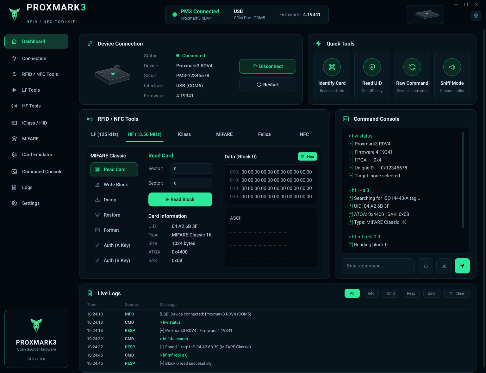

# Proxmark3 RFID / NFC Toolkit — GUI

A desktop **GUI mock-up** of a Proxmark3 RFID/NFC toolkit, built with
**PySide6 (Qt for Python)**. It faithfully reproduces the reference dashboard
design: brand header, connection status, quick tools, the RFID/NFC tool panel
(tabs, MIFARE tools, hex/ASCII viewer), a command console and a live-log table.

> ⚠️ This is a **user-interface layer only**. All values shown (UIDs, console
> output, logs, firmware, etc.) are **static sample data**. The app does **not**
> talk to a Proxmark3 or any hardware — it exists to demonstrate and refine the
> look & feel of the dashboard.



## Run it

### Windows
Double-click **`run.bat`** (or run it from a terminal). On first launch it
creates a local virtual environment, installs PySide6 and starts the app.

```bat
run.bat
```

### Linux / macOS
```bash
./run.sh
```

### Manual
```bash
python -m venv .venv
# Windows:  .venv\Scripts\activate
# Unix:     source .venv/bin/activate
pip install -r requirements.txt
python main.py
```

Requires **Python 3.9+**.

## Project layout

```
main.py                  Entry point
run.bat / run.sh         One-click launchers
requirements.txt         PySide6
app/
├── theme.py             Colour palette, fonts, metrics (sampled from design)
├── style.py             Global Qt stylesheet
├── icons.py             Crisp SVG line-icons rendered to QIcon/QPixmap
├── brand.py             Logo + device vector art
├── resources.py         Bundled-font loader
├── resources/fonts/     Exo 2 / Roboto / Roboto Mono (OFL)
├── widgets/             Reusable UI pieces
│   ├── common.py        Card, CardHeader, separators, label helper
│   ├── buttons.py       Nav items, tiles, pills, ghost/primary buttons
│   ├── sidebar.py       Left navigation rail + brand footer
│   ├── header.py        Top bar: wordmark, status, device, window controls
│   └── console.py       Command-console output + input
├── pages/
│   ├── dashboard.py     The fully-built Dashboard page
│   └── placeholder.py   Lightweight pages for other nav entries
└── main_window.py       Frameless window, sidebar + page stack
```

## Notes
- The window is **frameless** with custom minimise / maximise / close controls;
  drag the header to move it, double-click the header to maximise.
- The **Dashboard** is the polished page. Other sidebar entries open a tidy
  placeholder so navigation works end-to-end.
- Fonts are bundled, so rendering is consistent across machines with no network
  access required at runtime.

## Fonts & licensing
Bundled fonts (Exo 2, Roboto, Roboto Mono) are licensed under the
SIL Open Font License 1.1.
